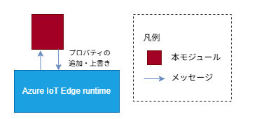
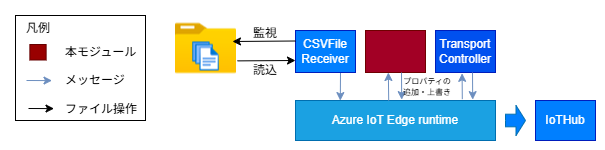

# IdentityMapping

## 目次
* [概要](#概要)
* [機能](#機能)
* [Quick Start](#quick-start)
* [イメージのURL](#イメージのurl)
* [動作保証環境](#動作保証環境)
* [Deployment 設定値](#deployment-設定値)
  * [環境変数](#環境変数)
  * [Desired Properties](#desired-properties)
  * [Create Option](#create-option)
  * [startupOrder](#startuporder)
* [受信メッセージ](#受信メッセージ)
  * [Message Body](#message-body)
  * [Message Properties](#message-properties)
* [送信メッセージ](#送信メッセージ)
  * [Message Body](#SendMessageBody)
  * [Message Properties](#SendMessageProperties)
* [Direct Method](#direct-method)
  * [SetLogLevel](#setloglevel)
  * [GetLogLevel](#getloglevel)
* [ログ出力内容](#ログ出力内容)
* [ユースケース](#ユースケース)
  * [ケース ①](#Usecase1)
* [Feedback](#feedback)
* [LICENSE](#license)

## 概要
IdentityMappingは、メッセージにプロパティ付与を行うAzure IoT edgeモジュールです。

## 機能

入力されたメッセージに対して任意のプロパティを追加／上書きしてメッセージを受け渡す。  
入力されたメッセージに編集するプロパティが設定されている場合、モジュールツインの設定値が優先され、上書きされる。



## Quick Start
1. Personal Access tokenを作成
（参考: [個人用アクセス トークンを管理する](https://docs.github.com/ja/authentication/keeping-your-account-and-data-secure/managing-your-personal-access-tokens)）

2. リポジトリをクローン
```
git clone https://github.com/Project-GAUDI/IdentityMapping.git
```

3. ./src/nuget_template.configの<GITHUB_USERNAME>と<PERSONAL_ACCESS_TOKEN>を自身のユーザー名とPersonal Access tokenに書き換えて、ファイル名をnuget.configに変更してください

4. Dockerイメージをビルド
```
docker image build -t <IMAGE_NAME> ./IdentityMapping/src/
```
例）
```
docker image build -t ghcr.io/<YOUR_GITHUB_USERNAME>/identitymapping:<VERSION> ./IdentityMapping/src/
```

5. Dockerイメージをコンテナレジストリにプッシュ
```
docker push <IMAGE_NAME>
```
例）
```
docker push ghcr.io/<YOUR_GITHUB_USERNAME>/identitymapping:<VERSION>
```

6. Azure IoT edgeで利用

## イメージのURL
準備中
| URL                                                             | Description          |
| --------------------------------------------------------------- | -------------------- |

## 動作保証環境

| Module Version | IoTEdge | edgeAgent | edgeHub | amd64 verified on | arm64v8 verified on | arm32v7 verified on |
| -------------- | ------- | --------- | ------- | ----------------- | ------------------- | ------------------- |
| 7.0.1          | 1.6.4   | 1.6.4     | 1.6.4   | ubuntu24.04       | －                  | －                  |

## Deployment 設定値

### 環境変数

#### 環境変数の値

| Key               | Type   | Required | Conditions                                  | Default | Description                     |
| ----------------- | ------ | -------- | ------------------------------------------- | ------- | ------------------------------- |
| TransportProtocol | string |          | ["Amqp", "Mqtt"]                            | Amqp    | ModuleClient の接続プロトコル。 |
| LogLevel          | string |          | ["trace", "debug", "info", "warn", "error"] | info    | 出力ログレベル。                |

### Desired Properties

#### Desired Properties の値

| JSON Key | Type | Required | Conditions | Default | Description |
| ---------------------------- | ------ | -------- | ---------- | ------- | ---------------------------------------------------------------------------------------------------------------------------------- |
| routes | object | 〇 | | | ルートの定義。 |
| &emsp; route[x] | object | 〇 | | | ルート設定を区別する為の任意のキー。ログ出力のみで使用。<br>キーの制約は無いが重複回避のためroute[x]を推奨。([x]は1から始まる連番) |
| &emsp; &emsp; input | string | 〇 | | | プロパティを編集するメッセージのインプット名。 |
| &emsp; &emsp; output | string | 〇 | | | プロパティを編集したメッセージを送信するアウトプット名。 |
| &emsp; &emsp; add_or_replace | object | 〇 | | | 追加／上書きするプロパティ情報。 |
| &emsp; &emsp; &emsp; key | string | 〇 | | | メッセージにプロパティを追加または上書きする際のキー。 |
| &emsp; &emsp; &emsp; value | string | 〇 | | | メッセージにプロパティを追加または上書きする際の値。 |

#### Desired Properties の記入例

```json
{
  "routes": {
    "route1": {
      "input": "input",
      "output": "output",
      "add_or_replace": {
        "country": "JP",
        "company": "01",
        "factory": "301",
        "data_type": "004",
        "free_area": "30103",
        "format": "007",
        "ProductionMode": "2"
      }
    }
  }
}
```

### Create Option

#### Create Option の値

なし

#### Create Option の記入例

```json
{}

```

### startupOrder

#### startupOrder の値

| JSON Key | Type | Required | Conditions | Default | Recommend | Description |
| ------------ | ------ | -------- | -------------------------- | ---------- | ---------- | ------------------------------------------------------ |
| startupOrder | number | | 0 以上 4294967295 以下の整数 | 4294967295 | 400 | モジュールの起動順序。数字が小さいほど先に起動される。 |

#### startupOrder の記入例

```json
{
  "startupOrder": 400
}
```

## 受信メッセージ

### Message Body

任意

### Message Properties

任意

### Message の例

```json
{
  "Body": {
    "RecordList": [
      {
        "RecordHeader": ["temperature", "humidity", "timestamp"],
        "RecordData": [
          ["25.5", "60.2", "2024-01-15T10:30:00Z"],
          ["26.1", "58.7", "2024-01-15T10:31:00Z"]
        ]
      }
    ]
  },
  "Properties": {
    "filename": "sensor_data_20240115.csv",
    "row_count": "2",
    "country": "US",
    "ProductionMode": "1"
  }
}
```

## 送信メッセージ

<a id="SendMessageBody"></a>

### Message Body

受信したメッセージのbodyをそのまま送信する

<a id="SendMessageProperties"></a>

### Message Properties

受信メッセージの既存プロパティに加えて、以下のプロパティが追加・上書きされる

| Key | Description |
| --------------------------------------------- | ------------------------------------------------ |
| モジュールツインの add_or_replace で設定した key | モジュールツインの add_or_replace で設定した value |

### Message の例

```json
{
  "Body": {
    "RecordList": [
      {
        "RecordHeader": ["temperature", "humidity", "timestamp"],
        "RecordData": [
          ["25.5", "60.2", "2024-01-15T10:30:00Z"],
          ["26.1", "58.7", "2024-01-15T10:31:00Z"]
        ]
      }
    ]
  },
  "Properties": {
    "filename": "sensor_data_20240115.csv",
    "row_count": "2",
    "country": "JP",
    "company": "01",
    "factory": "301",
    "data_type": "004",
    "free_area": "30103",
    "format": "007",
    "ProductionMode": "2"
  }
}
```

## Direct Method

### SetLogLevel

* 機能概要

  実行中に一時的にLogLevelを変更する。<br>
  変更はモジュール起動中または有効時間を過ぎるまで有効。<br>

* payload

  | JSON Key      | Type    | Required | default | Description |
  | ------------- | ------- | -------- | -------- | ----------- |
  | EnableSec     | integer  | 〇       |          | 有効時間(秒)。<br>-1:無期限<br>0:リセット(環境変数LogLevel相当に戻る)<br>1以上：指定時間(秒)経過まで有効。  |
  | LogLevel      | string  | △       |          | EnableSec=0以外を指定時必須。指定したログレベルに変更する。<br>["trace", "debug", "info", "warn", "error"]  |

  １時間"trace"レベルに変更する場合の設定例

  ```json
  {
    "EnableSec": 3600,
    "LogLevel": "trace"
  }
  ```

* response

  | JSON Key      | Type    | Description |
  | ------------- | ------- | ----------- |
  | status          | integer | 処理ステータス。<br>0:正常終了<br>その他:異常終了         |
  | payload          | object  | レスポンスデータ。         |
  | &nbsp; CurrentLogLevel | string  | 設定後のログレベル。（正常時のみ）<br>["trace", "debug", "info", "warn", "error"]  |
  | &nbsp; Error | string  | エラーメッセージ（エラー時のみ）  |

  ```json
  {
    "status": 0,
    "paylaod":
    {
      "CurrentLogLevel": "trace"
    }
  }
  ```

### GetLogLevel

* 機能概要

  現在有効なLogLevelを取得する。<br>
  通常は、LogLevel環境変数の設定値が返り、SetLogLevelで設定した有効時間内の場合は、その設定値が返る。<br>

* payload

  なし

* response

  | JSON Key      | Type    | Description |
  | ------------- | ------- | ----------- |
  | status          | integer | 処理ステータス。<br>0:正常終了<br>その他:異常終了         |
  | payload          | object  | レスポンスデータ。         |
  | &nbsp; CurrentLogLevel | string  | 現在のログレベル。（正常時のみ）<br>["trace", "debug", "info", "warn", "error"]  |
  | &nbsp; Error | string  | エラーメッセージ（エラー時のみ）  |

  ```json
  {
    "status": 0,
    "paylaod":
    {
      "CurrentLogLevel": "trace"
    }
  }
  ```

## ログ出力内容

| LogLevel | 出力概要 |
| -------- | ---------------------------------------------------------------------------------------------------------------------------------------------------- |
| error | [初期化/リソース解放/モジュールツイン更新/メッセージ送信/メッセージ受信]失敗<br>モジュールツインの必須項目未設定<br>[環境変数/モジュールツイン]がConditionsまたはType制約違反 |
| warn | エッジランタイムとの接続リトライ失敗 |
| info | [環境変数/モジュールツイン]の値<br>モジュールツイン更新通知<br>環境変数の省略可能項目未設定のためDefault値適用<br>メッセージ[送信/受信]通知 |
| debug | 無し |
| trace | リソース解放済み通知<br>メソッドの開始・終了<br>受信メッセージBody |

## ユースケース

<a id="Usecase1"></a>

### ケース①

IoTHubに送信するメッセージにデータ種別等の識別子をプロパティとして付与して送信する。



#### 起動順序 startupOrder

| 名称         | 値  |
| ------------ | --- |
| startupOrder | 400 |

#### 環境変数

| 名称              | 値   |
| ----------------- | ---- |
| TransportProtocol | Amqp |
| LogLevel          | info |

#### コンテナーの作成オプション Create Option

```json
{}
```

#### モジュールツインの設定

```json
{
 "routes": {
   "route1": {
     "input": "input",
     "output": "output",
     "add_or_replace": {
       "country": "JP",
       "company": "01",
       "factory": "301",
       "data_type": "004",
       "free_area": "30103",
       "format": "007",
       "ProductionMode": "2"
     }
   }
 }
}
```

#### 入力内容

```json
{
  "Body": {
      "RecordList": [
      {
        "RecordHeader": ["temperature", "humidity", "timestamp"],
        "RecordData": [
          ["25.5", "60.2", "2024-01-15T10:30:00Z"],
          ["26.1", "58.7", "2024-01-15T10:31:00Z"]
        ]
      }
    ]
  },
  "Properties": {
    "filename": "sensor_data_20240115.csv",
    "row_count": "2",
    "country": "US",
    "ProductionMode": "1"
  }
}
```

#### 出力例

CSVFileReceiverのメッセージにroute1で定義したプロパティを付与したメッセージ（既存プロパティは上書き）

```json
{
  "Body": {
      "RecordList": [
      {
        "RecordHeader": ["temperature", "humidity", "timestamp"],
        "RecordData": [
          ["25.5", "60.2", "2024-01-15T10:30:00Z"],
          ["26.1", "58.7", "2024-01-15T10:31:00Z"]
        ]
      }
    ]
  },
  "Properties": {
    "filename": "sensor_data_20240115.csv",
    "row_count": "2",
    "country": "JP",
    "company": "01",
    "factory": "301",
    "data_type": "004",
    "free_area": "30103",
    "format": "007",
    "ProductionMode": "2"
  }
}
```

## Feedback
お気づきの点があれば、ぜひIssueにてお知らせください。

## LICENSE
IdentityMapping is licensed under the MIT License, see the [LICENSE](LICENSE) file for details.
